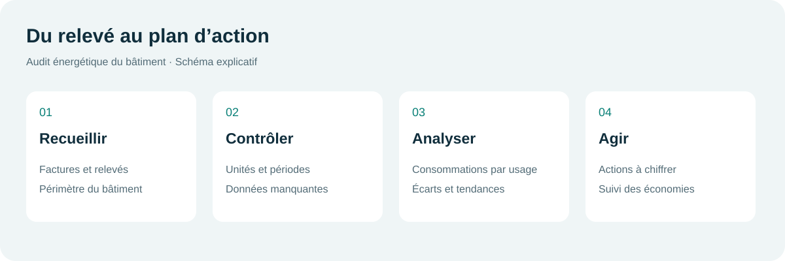
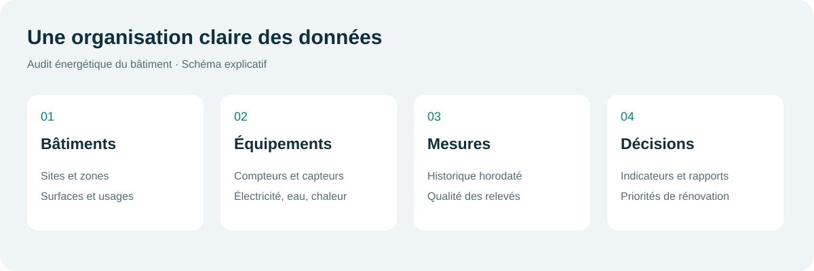

# EnerBat

Projet EnerBat présente dans cette archive.

## À quoi sert ce projet ?

Configurer les bâtiments, les compteurs et les données nécessaires au suivi des consommations d’énergie. Le nom de cette édition est **EnerBat**. EnerBat est le nom du projet.

## Présentation en français

- [Guide de prise en main](docs/guide-fr.html)
- [État réel du contenu et installation](docs/INSTALLATION_FR.md)

Ces schémas sont des illustrations explicatives, pas des captures d’une application exécutée ni des résultats d’audit réels.

## État de l’archive

L’archive contient du code d’administration, des bibliothèques et des scripts SQL. Les modèles HTML du dossier `enerbat-admin/views/`, le serveur `enerbat-api` et l’interface `enerbat-web` sont absents. L’administration ne peut donc pas fonctionner entièrement à partir de cette archive seule. Aucun résultat énergétique ni fonctionnement complet n’est revendiqué.

## Personnalisation française

Le français est imposé au chargement et à la connexion. Les anciennes captures multilingues et les liens promotionnels ont été retirés de cette édition. Un guide local remplace les renvois vers les chaînes vidéo externes. Les identifiants techniques, les bibliothèques tierces et les structures de base de données sont conservés pour éviter de casser les intégrations.

## Licence et origine

Projet original EnerBat, sans mention de licence externe.
